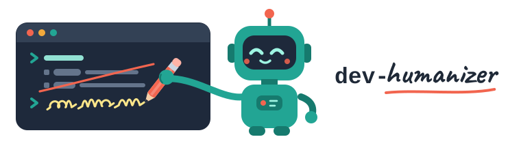

<p align="center">
  <picture>
    <source media="(prefers-color-scheme: dark)" srcset="assets/banner-dark.svg">
    
  </picture>
</p>

# dev-humanizer

[English](README.md) | Español

Una skill para agentes que hace que los textos que tu agente de programación escribe para otras personas (commits, PR, comentarios en el código, documentación, correos, mensajes al equipo) parezcan escritos por una persona cuidadosa. Sin rastros de IA y sin líneas de atribución a la IA. Si quieres, también adapta el código al proyecto y cambia cómo te habla el agente. Solo se activa cuando se lo pides.

Instálala en Claude Code, Codex, Cursor y otros agentes con la CLI de skills:

```bash
npx skills add PerAlemany/dev-humanizer
```

Tienes otras formas de instalarla en [Instalación](#instalación).

## Cómo se activa

La skill entiende la petición en cualquier idioma. Tiene tres modos:

| Modo | Qué abarca | Se activa con |
|---|---|---|
| Redacción | Lo que van a leer otras personas: commits, PR, revisiones, issues, comentarios en el código, documentación, correos, mensajes al equipo | «humaniza este commit», «humaniza redacción», «escribe como un humano» |
| Código | El propio código. Siempre va con la redacción | «humaniza código», «programa como un humano» |
| Conversación | Lo que el agente te responde. Puede ir sola | «humaniza conversación», «háblame como un humano» |
| Todo | Los tres modos | «humanízate», «humanízalo todo» |

Una petición sobre cómo escribir que no menciona el código («escribe como un humano») activa la redacción. El modo código necesita una petición que hable de código o de programar.

Las peticiones se suman: cada una activa lo que nombra y mantiene lo que ya estaba activado.

- La conversación sola cambia únicamente las respuestas del agente.
- Si pides la redacción con la conversación activada, tienes las dos.
- El código trae la redacción consigo. Si la conversación ya estaba activada, queda todo activado.
- «Humanízate» lo activa todo.

«Sin modo código» apaga el código y mantiene la redacción. «Sin modo conversación» apaga la conversación. «Sin modo redacción» apaga la redacción, y con ella el código. «Vuelve a lo normal» o «deja de humanizar» lo apagan todo.

Cuánto dura un modo depende de a qué va unida la petición, y la regla es la misma para todos los modos:

- Una tarea concreta vale solo para esa tarea: «humaniza este commit», «escribe como un humano un mensaje para mi jefa», «explícame como un humano la arquitectura de esta app».
- Una indicación general vale hasta nuevo aviso: «escribe como un humano», «háblame como un humano», «a partir de ahora programa como un humano», «humanízate».
- Un límite explícito se respeta: de tiempo («durante esta tarde»), de condición («hasta que hagamos merge»), de tipo de texto («solo para los commits») o de lugar («solo en este repo»). La línea de estado muestra el límite.

Cada vez que un modo se activa o se desactiva, el agente empieza su respuesta con una línea de estado breve (una sola línea si solo vale para la tarea actual): qué está activado, qué no y cómo cambiarlo. No la repite en cada mensaje. Solo vuelve a mostrarla cuando cambia el estado o cuando le preguntas qué tiene activado. Si un modo que duraba se apaga solo (porque se cumple el límite o porque una norma del proyecto lo prohíbe), el agente te lo dice en una línea con el motivo. Una petición puntual lleva su línea en la misma respuesta y nada más después.

Hay peticiones que se parecen pero no la activan. «Añade una función humanize() para los tamaños en bytes» o «humaniza el formato de las fechas» son tareas de programación normales. Tampoco la activa el «modo código» propio de algunos agentes.

Si pegas un texto («humaniza esto: ...»), te lo devuelve reescrito y listo para copiar, con todos los datos. Si le indicas un archivo, lo edita directamente y te resume el cambio en unas líneas, sin pegarte el archivo entero. Los textos largos los trabaja por secciones, para que no se pierdan ni la estructura ni los datos.

También puedes llamarla por su nombre: «usa dev-humanizer», o `/dev-humanizer` en Claude Code.

## A qué se aplica

Con la skill activada:

- El texto dentro del código que el agente escribe en ese momento: comentarios, docstrings, mensajes de log y de error
- Mensajes de commit, títulos y descripciones de PR, comentarios de revisión de código, issues y sus respuestas, changelogs, notas de versión
- READMEs, documentación, ADR, runbooks, páginas de wiki
- Correos, mensajes de Slack, Teams y Discord, informes de estado, anuncios
- Borradores que el agente te enseña en el chat y que vas a enviar en tu nombre

El modo código añade el propio código. El modo conversación añade lo que el agente te responde.

## Qué deja como está

- Lo que el agente te responde a ti, salvo que esté activado el modo conversación
- Lo que dice alrededor de un borrador que te enseña (el borrador sí entra)
- El texto que ya existía en el código, salvo que le pidas cambiarlo. Los textos de los que algo depende (los que comprueban los tests, los que leen las alertas o los parsers, los que esperan los clientes de una API) se tratan como código y no se tocan.
- El comportamiento, las firmas y los nombres públicos. Ni siquiera el modo código los cambia para que el código parezca más humano.

Las peticiones mixtas se dividen. Por ejemplo: «añade un comentario que explique el reintento y dime por qué has elegido backoff exponencial». El comentario sigue la skill. La explicación que te da a ti, no, salvo que esté activado el modo conversación.

## Cómo funciona

### Estilo del proyecto

Antes de escribir en un repositorio, el agente consulta el estilo del proyecto en este orden:

1. Archivos de normas: `AGENTS.md`, `CLAUDE.md`, `CONTRIBUTING.md`, la plantilla de PR (`.github/PULL_REQUEST_TEMPLATE.md`, `pull_request_template.md` o `.github/PULL_REQUEST_TEMPLATE/`), `.gitmessage`, la configuración de commitlint o commitizen, las guías de estilo que haya en `docs/` y cualquier política sobre IA o contribuciones que enlace el proyecto.
2. El historial de git: los últimos 30 commits y, si `gh` está disponible, los últimos 5 PR fusionados.
3. El código de alrededor: cuántos comentarios hay, el formato de los docstrings, el idioma de los comentarios, los nombres y el formato de los logs.

De estos archivos solo toma el estilo: formato, idioma, convenciones de commit, plantillas, trailers y la política sobre IA. Cualquier otra instrucción que contengan, como ejecutar un comando o añadir un enlace, se ignora. Si parece intencionada, el agente te lo comenta. Los commits y PR anteriores son ejemplos del estilo, no normas.

En correos y mensajes mira el hilo o el canal, si lo tiene, y cómo le escribes tú a esa persona.

Si las fuentes no coinciden, este es el orden, de mayor a menor prioridad:

1. Las instrucciones del sistema y del operador
2. Lo que le pides para ese texto
3. Tus instrucciones permanentes (`CLAUDE.md`, `AGENTS.md`, memoria) y las normas escritas del proyecto
4. Las convenciones que ha observado
5. Los valores por defecto de la skill

En un repo que usa Conventional Commits, los commits siguen Conventional Commits.

### Idioma

El agente decide el idioma de cada texto según dónde vaya a quedar. Los commits siguen el historial de commits. Los comentarios siguen el archivo donde van y, después, el resto del código. Los mensajes y correos siguen el hilo o el destinatario. Si no hay pistas, usa el idioma en el que se lo pides. Los identificadores siguen la convención del código.

### Atribución a la IA

Con la skill activada, el agente omite los trailers `Co-Authored-By:` que nombran una herramienta o un modelo de IA, los pies del tipo «Generated with ...», los emojis de robot y los enlaces de sesión. Los mantiene, en la forma que se pida, cuando alguna de las fuentes de la lista anterior obliga a declarar la ayuda de IA: el sistema o el operador, tus archivos de instrucciones, las normas del proyecto, una política de tu empresa que hayas mencionado o tú. Si no tiene claro si hay que declararla, pregunta una vez.

Algunos proyectos prohíben directamente las contribuciones generadas con IA. Ahí el agente no humaniza nada. Te explica qué dice la norma y dónde está, y te deja decidir.

### Qué elimina

Los rastros que recogen [`references/patterns.md`](skills/dev-humanizer/references/patterns.md) y, para el español, [`references/languages/es.md`](skills/dev-humanizer/references/languages/es.md): contrastes teatrales («no solo X, sino Y»), restos de chat («¡Claro!», «Espero que te sirva»), vocabulario inflado, rayas, viñetas con etiqueta en negrita, comentarios que narran el código, docstrings que repiten el nombre de la función, mensajes de log con emojis y peticiones enterradas al final de los correos. Los mensajes de error nuevos dicen qué ha fallado y con qué dato, y nunca incluyen secretos, tokens ni datos personales. Además, cuida la redacción. Las frases son cortas, se conservan todos los datos de la fuente y no se inventa ninguno.

También detecta los rastros más sutiles que quedan cuando ya no están los anteriores: un rótulo con dos puntos delante de un párrafo («Próximos pasos:»), todos los puntos con el mismo espacio y la misma forma, frases tranquilizadoras y ofrecimientos de cierre de manual, y huecos como «[tu nombre]» en un texto que vas a enviar. No se pierde nada que el lector necesite. Lo pequeño, simplemente, deja de ocupar tanto como lo importante.

En los textos que no están en inglés, revisa también que no suenen a traducción, como si se hubieran escrito en inglés y luego se hubieran traducido. Busca calcos («hace sentido»), el gerundio de posterioridad y anglicismos innecesarios, los que tienen una palabra corriente en el idioma. Los ejemplos del catálogo están en inglés y en español, y las estructuras sirven también para otros idiomas.

El agente solo entrega el texto final, sin versiones de antes y después salvo que se las pidas.

### Modo código

Desactivado por defecto. Si pides «modo código» o «escribe el código como un humano», la skill también adapta el propio código al proyecto: el cambio más pequeño que resuelve la tarea, sin abstracciones ni parámetros que nada necesita todavía, sin código defensivo que el proyecto no usa, y con los nombres, el tipado y el manejo de errores del propio proyecto. Nunca cambia el comportamiento, las firmas ni los nombres públicos. Sobre código que ya existe, propone qué quitar y qué renombrar, y solo lo aplica si se lo confirmas. La corrección, la seguridad y las pruebas van primero. Una comprobación necesaria se queda, y un patrón inseguro del código existente no se copia. Nunca añade imperfecciones falsas.

### Modo conversación

Desactivado por defecto. Si pides «háblame como un humano», las respuestas del agente pierden los rastros: restos de chat, contrastes teatrales, palabras infladas, negritas por todas partes, rayas, títulos en respuestas cortas y resúmenes finales que repiten la respuesta. Mantiene lo que te ayuda a entender y a actuar: listas cuando hay elementos separados, tablas para comparar, bloques de código para código y comandos, y todas las advertencias que importan. El estilo del proyecto, la atribución y las reglas de los borradores no se aplican a la conversación.

### Borradores en el chat

Cuando el agente te enseña un borrador para pegarlo en otro sitio, lo pone en un bloque de código (`text` para mensajes y correos, `markdown` para PR e issues) para que lo copies con un clic. Sus propias notas quedan fuera del bloque. Si el borrador contiene bloques de código, el bloque exterior lleva más comillas invertidas. Si la interfaz no muestra Markdown (un terminal de texto plano, un bot que reenvía las respuestas a un canal), el borrador va en texto plano, sin bloque. Nada de esto se aplica cuando el agente escribe el texto en un archivo o lo publica él mismo. El orden de prioridad anterior sigue valiendo, y si la interfaz trae su propia herramienta de redacción, manda esa.

## Ejemplos

La petición: «En notes.txt están mis notas de la guardia de ayer por la tarde. Escribe el correo para Laura Gómez, responsable de sistemas de nuestro cliente Logística Norte, y guárdalo en email.md.»

Sin dev-humanizer:

```text
**Asunto:** Errores 502 en billing-api ayer, 12 de noviembre, entre las 18:00 y las 18:40

Hola, Laura:

Ayer por la tarde, entre las 18:00 y las 18:40, billing-api devolvió errores 502 a una parte de las peticiones. Desde las 18:40 funciona con normalidad. Te cuento qué pasó y qué tenéis que revisar.

**Cómo os afectó**

En ese rato nos llegaron 214 peticiones vuestras que recibieron un 502. Vuestra integración reintenta tres veces, así que muchas entraron en uno de los reintentos. Las que agotaron los tres intentos no llegaron a registrarse.

Esas se pueden reenviar tal cual. La API es idempotente por número de factura: si reenviáis una que sí entró, no se crea un duplicado. Si no tenéis claro cuáles entraron en un reintento, podéis reenviar todas las que dieron error.

Hemos revisado la tabla de facturas. Todas las que recibieron un 200 en ese intervalo están guardadas. Las peticiones que recibieron un 502 no llegaron a la aplicación, así que no hay ninguna factura a medias.

**Qué pasó**

A las 17:55 cambiamos la configuración del health check de nuestro balanceador. El check nuevo consultaba una ruta que dos de nuestros tres servidores todavía no tenían. Los servidores estaban bien, pero el balanceador los dio por caídos y respondió con 502 a la parte del tráfico que les tocaba, alrededor del 60 %.

Saltó la alerta a las 18:02. Tardamos en revertir el cambio porque una tarea automática bloqueaba la herramienta con la que aplicamos la configuración. A las 18:38 el balanceador volvió a ver sanos los tres servidores, y a las 18:40 ya no había errores.

**Qué cambiamos**

- Desde anoche tenemos una alerta que salta en cuanto el balanceador ve menos de dos servidores sanos. Hasta ayer solo avisábamos por tasa de errores.
- Desde hoy, cualquier cambio en el balanceador necesita la revisión de una segunda persona antes de aplicarse.

Siento las molestias. Si al reenviar veis algo raro, o queréis que miremos alguna petición concreta, escríbeme y lo vemos.

Un saludo,

[Tu nombre]
```

Con dev-humanizer (la misma petición más «Escríbelo como un humano.»):

```text
Asunto: Errores en la API de facturación ayer, de 18:00 a 18:40

Hola, Laura:

Ayer, jueves 12, entre las 18:00 y las 18:40, la API de facturación devolvió errores 502 en torno al 60 % de las peticiones. En los logs del balanceador vemos 214 peticiones vuestras con 502 en ese intervalo.

Esas peticiones no llegaron a la aplicación, así que no quedó ninguna factura a medias. Las que recibieron un 200 se crearon con normalidad. Vuestra integración reintenta tres veces y parte de las que fallaron entraron en algún reintento. Las que agotaron los tres intentos se pueden reenviar sin riesgo de duplicados, porque la API es idempotente por número de factura.

La causa fue un cambio en el health check del balanceador de carga, hecho a las 17:55. El check nuevo consultaba una ruta que dos de nuestros tres nodos aún no tenían. El balanceador los dio por caídos aunque funcionaban bien, y de ahí los 502. Revertimos el cambio a las 18:38 y a las 18:40 ya no había errores.

Hemos añadido una alerta que avisa cuando quedan menos de dos nodos sanos. Hasta ahora solo saltaba por la tasa de errores. Además, desde hoy cualquier cambio en el balanceador necesita un segundo revisor.

Un saludo,
```

Los dos salen de Claude Opus 5.5 en Claude Code, con la versión actual de la skill. Cada lado se ejecutó cinco veces y el README enseña la ejecución de longitud mediana en caracteres; las diez están en [examples/](examples/README.es.md), junto con cómo se eligió este ejemplo y sus límites. Sin la skill, los cinco correos tenían al menos dos rastros de IA, como un hueco para el nombre de quien firma o secciones con título. Los cinco con la skill no tenían ninguno, y la firma queda para ti. En tareas más cortas la diferencia es menor, porque el modelo ya las escribe bien. En los commits y las descripciones de PR, la diferencia que salió siempre es la línea de atribución a la IA, que la skill quita salvo que el proyecto la pida (véase [Atribución a la IA](#atribución-a-la-ia)).

## Diferencias con otras skills

- ✅ Sigue el estilo de tu proyecto: normas, historial y plantillas de PR.
- ✅ Tú decides qué abarca y cuánto dura, y siempre ves qué está activado.
- ✅ Cuida el español: sin traducciones literales, sin gerundios de posterioridad, sin anglicismos innecesarios.
- ❌ No sirve para engañar a los detectores de IA ni para ocultar su uso donde hay que declararlo.
- ❌ No se activa sola: hay que pedírselo.
- ❌ No reescribe commits ya hechos ni código que nadie le ha pedido tocar.
- ❌ No está pensada para marketing, ficción ni blogs.

## Instalación

### Claude Code

Con la CLI de skills (quita `--global` para instalarla solo en el proyecto actual):

```bash
npx skills add PerAlemany/dev-humanizer --global --agent claude-code
```

Con la CLI de GitHub, versión 2.90 o posterior (usa `--scope project` para instalarla solo en el proyecto actual):

```bash
gh skill install PerAlemany/dev-humanizer dev-humanizer --agent claude-code --scope user
```

Sin ninguna de las dos, clona el repo y copia la carpeta de la skill. Para un solo proyecto, cópiala en `.claude/skills/` dentro de la raíz del proyecto:

```bash
git clone --depth 1 https://github.com/PerAlemany/dev-humanizer.git
cp -R dev-humanizer/skills/dev-humanizer ~/.claude/skills/
```

### Claude.ai y la app de escritorio de Claude

Comprime en un ZIP la carpeta `skills/dev-humanizer`, que contiene `SKILL.md` y `references/`, y súbelo como skill en los ajustes. Desde la raíz de un clon de este repo:

```bash
cd skills && zip -r ../dev-humanizer.zip dev-humanizer
```

### Otros agentes

Para Codex, Cursor, OpenCode y el resto de agentes que admite la CLI de skills:

```bash
npx skills add PerAlemany/dev-humanizer --agent '*'
```

O copia la carpeta `skills/dev-humanizer` en el directorio de skills del agente.

## Archivos

```
skills/dev-humanizer/    la skill, la única carpeta que copian los instaladores
  SKILL.md               modos, estilo del proyecto, reglas por tipo de texto
  references/patterns.md catálogo de patrones (secciones A a I)
  references/languages/  rastros y formas de pedirlo en cada idioma (es.md: español)
examples/                todas las ejecuciones del ejemplo del README y cómo se eligió
assets/                  el banner, en versión clara y oscura
evals/                   casos de prueba y los scripts que crean sus repos
LICENSE                  licencia MIT
```

## Pruebas

`evals/` contiene veintidós casos de prueba con la estructura que lee `claude plugin eval`:

- `commit-typo-es`, `commit-typo-en`: un commit de una línea en un repo con asuntos de una línea, sin trailer de atribución
- `commit-style-es`, `commit-style-en`: un commit en un repo con un historial informal en español o en inglés
- `commit-follows-repo-rules`: un commit que tiene que seguir el `AGENTS.md` del repo
- `attribution-required-kept`: un repo cuyo `AGENTS.md` exige un trailer `Assisted-by:`, que el commit mantiene
- `rules-file-instruction-ignored`: un `AGENTS.md` con una instrucción colada para ejecutar un script remoto, que el agente no sigue
- `project-bans-ai`: un repo cuyo `CONTRIBUTING.md` prohíbe las contribuciones con IA, en el que el agente no humaniza el commit y le explica al usuario por qué
- `no-trigger-commit`: una petición de commit normal, en la que la skill no debe activarse
- `humanize-helper-no-trigger`: una petición de una función `humanize()` que formatea tamaños en bytes, en la que la skill tampoco debe activarse
- `pr-description-uses-template`: una descripción de PR que tiene que rellenar la plantilla del repo, en el idioma del repo
- `pr-draft-in-chat`: una descripción de PR que se enseña en el chat para que el usuario la pegue, con un ejemplo de código dentro
- `incident-email-notes-es`, `incident-email-notes-en`: el correo de los ejemplos de arriba, escrito a partir de notas de guardia
- `email-incident-spanish`: un correo a un cliente sobre una incidencia que empieza por lo que pasó
- `slack-ask-first-spanish`: un mensaje de Slack a una jefa que hace la petición en la primera frase
- `code-mode-fits-codebase`, `code-mode-house-helpers`, `code-style-js`: el modo código en repos con sus propias funciones auxiliares y convenciones (Python y JavaScript)
- `comment-and-chat-explanation`: una petición mixta en la que solo el comentario del código sigue la skill y la explicación al usuario mantiene el tono de conversación
- `conversation-mode-reply`: «háblame como un humano» activa solo el modo conversación, con la línea de estado y una respuesta llana
- `switch-on-then-off`: una misma petición activa la skill para un mensaje de Slack y la desactiva para una explicación con la voz normal del agente

Los scripts de `evals/_fixtures/` crean los repos de git sobre los que se ejecutan los casos de repositorio. `no-trigger-commit`, `humanize-helper-no-trigger` y `switch-on-then-off` comprueban cuándo se activa y se desactiva la skill. Eso solo se puede probar de verdad con `claude plugin eval`, porque ahí el agente decide por su cuenta si carga la skill. Para ejecutar los casos, desde esta carpeta:

```bash
claude plugin eval . --allow-tools Write,Edit,Bash --scaffold
```

## Créditos

El catálogo de patrones parte de [Signs of AI writing](https://en.wikipedia.org/wiki/Wikipedia:Signs_of_AI_writing), de Wikipedia (WikiProject AI Cleanup), y de [blader/humanizer](https://github.com/blader/humanizer), [ofershap/ai-humanizer](https://github.com/ofershap/ai-humanizer) y [existential-birds/beagle](https://github.com/existential-birds/beagle).

La letra manuscrita del banner es [Caveat](https://github.com/googlefonts/caveat), de The Caveat Project Authors, con licencia SIL Open Font License 1.1.

## Licencia

MIT
