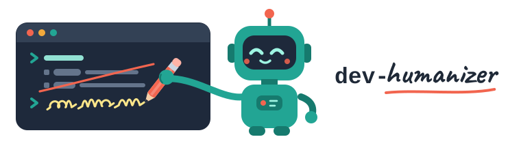

<p align="center">
  <picture>
    <source media="(prefers-color-scheme: dark)" srcset="assets/banner-dark.svg">
    
  </picture>
</p>

# dev-humanizer

English | [Español](README.es.md)

An agent skill that makes the text your coding agent writes for other people (commits, PRs, code comments, docs, emails, team messages) read like a careful human wrote it. It leaves out AI tells and AI attribution lines. On request it also makes the code fit the project and changes how the agent talks to you. It stays off until you ask for it.

Install it for Claude Code, Codex, Cursor and other agents with the skills CLI:

```bash
npx skills add PerAlemany/dev-humanizer
```

Other ways to install it are under [Install](#install).

## Turning it on

The examples below are in English, but the skill understands the request in any language. It has three modes:

| Mode | What it covers | Ask for it with |
|---|---|---|
| Prose | Text other people will read: commits, PRs, reviews, issues, code comments, docs, emails, team messages | "humanize this commit", "humanize prose", "write like a human" |
| Code | The code itself. Always comes with prose mode | "humanize code", "code like a human" |
| Conversation | The agent's replies to you. Can run on its own | "humanize conversation", "talk to me like a person" |
| Everything | The three modes | "humanize yourself", "humanize everything" |

A request about writing that doesn't mention code ("write like a human") means prose mode. Code mode needs a request that names code or programming.

Requests add up: each one turns on what it names and keeps what was already on.

- Conversation on its own changes only the agent's replies.
- Asking for prose mode while conversation is on gives you both.
- Code brings prose mode with it. If conversation was already on, that's everything.
- "Humanize yourself" turns on everything.

"No code mode" turns off code and keeps prose mode. "No conversation mode" turns off conversation. "No prose mode" turns off prose mode, and code with it. "Back to normal" or "stop humanizing" turn everything off.

How long a mode stays on depends on what the request is attached to, and the rule is the same for every mode:

- A concrete task covers that task only: "humanize this commit", "write my manager a message like a human", "explain this app's architecture like a human".
- A general statement stays on until you say otherwise: "write like a human", "talk to me like a person", "from now on, code like a human", "humanize yourself".
- An explicit limit is followed: a time ("this afternoon"), a condition ("until we merge"), a kind of text ("only commits") or a place ("only in this repo"). The status line shows the limit.

Whenever a mode turns on or off, the agent starts its reply with a short status line (a single line when it covers only the current task): what's on, what's off and how to change it. It doesn't repeat the line on every message, only when the state changes or when you ask what's on. If a lasting mode turns off on its own (a limit is reached, a project rule forbids it), the agent says so in one line, with the reason. A one-off request gets its line in the same reply and nothing afterwards.

Some requests sound similar but don't turn it on. "Add a humanize() helper for byte sizes" or "humanize the timestamps" are ordinary coding tasks. So is switching on an agent's own "code mode" in tools that have one.

Text you paste ("humanize this: ...") comes back rewritten and ready to copy, with every fact kept. A file you point to is edited in place, and the agent sums up the change in a few lines instead of pasting the file. Long texts are done section by section, so the structure and the facts survive.

You can also name it: "use dev-humanizer", or `/dev-humanizer` in Claude Code.

## What it applies to

With the skill on:

- The text inside code the agent writes now: comments, docstrings, log and error messages
- Commit messages, PR titles and descriptions, code review comments, issues and replies, changelogs, release notes
- READMEs, docs, ADRs, runbooks, wiki pages
- Emails, Slack, Teams and Discord messages, status updates, announcements
- Drafts the agent shows you in chat that you will send as yourself

Code mode adds the code itself. Conversation mode adds the agent's replies to you.

## What it leaves alone

- The agent's replies to you, unless conversation mode is on
- The framing around a draft it shows you (the draft itself is covered)
- Text that already exists in the code, unless you ask. Strings that tests, alerts, parsers or API clients depend on are treated as code and stay as they are.
- Behaviour, signatures and public names. Not even code mode changes them to make code look more human.

Mixed requests get split. Take "add a comment explaining the retry and tell me why you picked exponential backoff". The comment follows the skill. The explanation to you doesn't, unless conversation mode is on.

## How it works

### House style

Before writing in a repository, the agent reads the house style in this order:

1. Rules files: `AGENTS.md`, `CLAUDE.md`, `CONTRIBUTING.md`, the PR template (`.github/PULL_REQUEST_TEMPLATE.md`, `pull_request_template.md` or `.github/PULL_REQUEST_TEMPLATE/`), `.gitmessage`, commitlint or commitizen config, style guides under `docs/` and any AI or contribution policy the project links to.
2. Git history: the last 30 commits, and the last 5 merged PRs if `gh` is available.
3. The surrounding code: comment density, docstring format, comment language, naming, log format.

It reads these files for style only: format, language, commit conventions, templates, trailers and AI policy. Any other instruction in them, such as running a command or adding a link, is ignored. If it looks deliberate, the agent mentions it to you. Past commits and PRs are examples of the style, not rules.

For emails and messages it looks at the thread or channel, if it has one, and at how you write to that person.

When sources disagree, this is the order, highest first:

1. System and operator instructions
2. What you tell it for this piece
3. Your standing instructions (`CLAUDE.md`, `AGENTS.md`, memory) and the project's written rules
4. The conventions it observed
5. The skill's defaults

A repo that uses Conventional Commits gets Conventional Commits.

### Language

The agent picks the language for each piece from where it will live. Commits follow the commit history. Code comments follow the file, then the rest of the codebase. Messages and emails follow the thread or the recipient. With no clues, it uses the language of your request. Code identifiers follow the codebase.

### AI attribution

With the skill on, the agent leaves out `Co-Authored-By:` trailers that name an AI tool or model, "Generated with ..." footers, robot emoji and session links. It keeps them, in the form required, when any source in the list above requires disclosure: the system or operator, your instruction files, the project's rules, a company policy you've mentioned, or you. If it can't tell whether disclosure is required, it asks once.

Some projects forbid AI-generated contributions altogether. There the agent doesn't humanize anything. It tells you what the rule says and where it is, and leaves the decision to you.

### What it removes

The tells listed in `references/patterns.md`: staged contrasts ("not just X, but Y"), chat residue ("Certainly!", "I hope this helps"), inflated vocabulary, em dashes, bold-label bullets, narrating comments, tautological docstrings, emoji log messages and asks buried at the end of emails. New error messages say what failed and with which input, and never include secrets, tokens or personal data. It also looks after the writing itself. Sentences are short, every fact from the source is kept and none is invented.

It also catches the subtler signs left once those are gone: a label with a colon in front of a paragraph ("Next steps:"), every item given the same space and the same shape, stock reassurance and closing offers, and placeholders like "[your name]" in a text you're about to send. Nothing the reader needs is dropped. The small points just stop taking as much room as the important one.

Non-English text gets a check for translationese, the signs that a text was composed in English and then translated. That means expressions translated word for word, a gerund tacked on at the end of a Spanish sentence to add a consequence, and English loanwords where the language has a common word of its own. The catalog's examples are in English and Spanish, and the structures carry over to other languages.

The agent outputs only the final text, with no before/after versions unless you ask for them.

### Code mode

Off by default. Ask for "code mode" or "write the code like a human", and the skill also shapes the code itself to fit the project: the smallest change that solves the task, no abstractions or parameters nothing needs yet, no defensive code the codebase doesn't use, and the project's own naming, typing and error handling. It never changes behaviour, signatures or public names. On existing code it proposes removals and renames, and applies them only if you confirm. Correctness, security and tests come first. A needed check stays, and an unsafe pattern in the codebase isn't copied. It never adds fake imperfections.

### Conversation mode

Off by default. Ask for "talk to me like a person", and the agent's replies to you lose the tells: chat residue, staged contrasts, inflated words, bold everywhere, em dashes, headings on short answers and closing summaries that repeat the answer. It keeps what helps you understand and act: lists for separate items, tables for comparisons, code blocks for code and commands, and every caveat that matters. House style, attribution and draft rules don't apply to the conversation.

### Drafts shown in chat

When the agent shows you a draft to paste elsewhere, the draft goes in a fenced block (`text` for messages and emails, `markdown` for PRs and issues) so you can copy it in one click. Its own notes stay outside the block. If the draft contains code blocks, it uses a longer outer fence. If the interface doesn't render Markdown, such as a plain-text terminal or a bot that relays replies to a channel, the draft comes as plain text without fences. None of this applies when the agent writes the text to a file or posts it itself. The precedence order above still holds, and a drafting tool built into the interface wins when there is one.

## Examples

The request: "notes.txt has my on-call notes from yesterday evening. Write the email to Laura Bennett, head of IT at our client Northern Freight, and save it in email.md."

Without dev-humanizer:

```text
**Subject:** Billing API errors yesterday, 17:55–18:40: what happened and what to resend

Hi Laura,

Yesterday evening (Thursday 12 November), from about 17:55 to 18:40, part of the requests to our billing API failed with a 502 error. Northern Freight sent 214 requests that got a 502 in that window.

**What you need to do**

Your integration retries each request 3 times, so some of those 214 went through on a later attempt. Any that still failed after the last retry need to be sent again. Resending is safe: the API matches invoices by invoice number, so a request that already went through won't create a duplicate. If it's easier to resend all 214, that's fine too.

No data was lost or left half-written. The failed requests were rejected by our load balancer and never reached the billing system. Every invoice that got a 200 response was saved correctly. We've checked that against the invoices table.

If you'd like, we can send you the list of the 214 failed requests from our logs so you can check them against yours.

**What happened**

At 17:55 we changed a setting on the load balancer that decides which servers can take traffic. The new setting checked an address that two of our three servers don't have, so the load balancer took those two out of service even though they were working normally. That left one server, and about 60% of requests failed.

Our monitoring alerted us at 18:02. Undoing the change took longer than it should have because a problem in our deployment tooling blocked it at first. We reverted it at 18:38 and errors stopped at 18:40.

**What we've changed**

- We now get an alert as soon as fewer than two servers are taking traffic. Before, we only alerted on the error rate.
- From today, every load balancer change needs a second person to review it before it goes live.

Sorry for the disruption. If anything still looks wrong on your side, or you want to go through the details, just reply to this email.

Best regards,
[Your name]
```

With dev-humanizer (the same request plus "Write it like a human."):

```text
Subject: Billing API errors yesterday between 18:00 and 18:40

Hi Laura,

Yesterday between 18:00 and 18:40 our billing API returned 502 errors for part of its traffic, and 214 of Northern Freight's requests were affected. Your integration retries three times, so some of them went through later. The rest need to be resent. It's safe to resend all 214: the API is idempotent by invoice number, so an invoice that already went through won't be created twice.

Nothing was lost or half-written. Every invoice that got a 200 in that window is in our system, and the requests that got a 502 never reached the application.

The cause was a change to our load balancer's health check at 17:55. The new check looked for a health endpoint that two of our three servers don't have, so the load balancer marked them as unhealthy even though they were working, and about 60% of requests failed. We were paged at 18:02, reverted the change at 18:38, and errors were back to zero by 18:40.

We've added an alert that fires as soon as fewer than two servers are healthy. Until now we only alerted on the error rate. And from today, every load balancer change needs a second reviewer.

Sorry for the disruption.

Best,
```

Both come from Claude Opus 5.5 in Claude Code, with the current version of the skill. Each side was run five times, and the README shows the run of median length in characters; all ten are in [examples/](examples/), along with how this example was chosen and its limits. Without the skill, all five emails had at least two AI tells, such as a placeholder for the sender's name or headed sections. None of the five with the skill had any, and the signature is left to you. On shorter tasks the difference is smaller, because the model already writes them well. In commits and PR descriptions, the difference that showed up every time is the AI attribution line, which the skill drops unless the project asks for it (see [AI attribution](#ai-attribution)).

## How it differs

- ✅ Follows your project's style: rules files, history and PR templates.
- ✅ You decide what it covers and for how long, and you always see what's on.
- ✅ Takes care of non-English text: no literal translations, no tacked-on gerunds of consequence, no unnecessary anglicisms.
- ❌ It isn't a way to get past AI detectors or to hide AI use where it has to be disclosed.
- ❌ It doesn't turn on by itself: you have to ask.
- ❌ It doesn't rewrite past commits or code nobody asked it to touch.
- ❌ It isn't meant for marketing copy, fiction or blog posts.

## Install

### Claude Code

For all your projects:

```bash
git clone https://github.com/PerAlemany/dev-humanizer.git ~/.claude/skills/dev-humanizer
```

For one project, from its root:

```bash
git clone https://github.com/PerAlemany/dev-humanizer.git .claude/skills/dev-humanizer
```

With the skills CLI (drop `--global` to install for the current project only):

```bash
npx skills add PerAlemany/dev-humanizer --global --agent claude-code
```

### Claude.ai and the Claude desktop app

Zip the `dev-humanizer` folder with `SKILL.md` and `references/` inside, then upload the ZIP as a skill in Settings. From the folder that contains `dev-humanizer`:

```bash
zip -r dev-humanizer.zip dev-humanizer/SKILL.md dev-humanizer/references
```

### Other agents

For Codex, Cursor, OpenCode and other agents the skills CLI supports:

```bash
npx skills add PerAlemany/dev-humanizer --agent '*'
```

Or copy the `dev-humanizer` folder into the agent's skills directory.

## Files

```
SKILL.md                 modes, house style, rules for each kind of text
examples/                every run behind the README example, and how it was chosen
assets/                  the banner, in light and dark versions
references/patterns.md   pattern catalog (sections A to I), English and Spanish examples
evals/                   test cases and the scripts that build their repos
LICENSE                  MIT license
```

## Tests

`evals/` holds twenty-two test cases in the layout `claude plugin eval` reads:

- `commit-typo-es`, `commit-typo-en`: a one-line commit in a repo with plain one-line subjects, with no attribution trailer
- `commit-style-es`, `commit-style-en`: a commit in a repo whose history is casual Spanish or English
- `commit-follows-repo-rules`: a commit that has to follow the repo's `AGENTS.md`
- `attribution-required-kept`: a repo whose `AGENTS.md` requires an `Assisted-by:` trailer, which the commit keeps
- `rules-file-instruction-ignored`: an `AGENTS.md` with a planted instruction to run a remote script, which the agent doesn't follow
- `project-bans-ai`: a repo whose `CONTRIBUTING.md` forbids AI contributions, where the agent doesn't humanize the commit and tells the user why
- `no-trigger-commit`: a plain commit request, where the skill must not run
- `humanize-helper-no-trigger`: a request for a `humanize()` function that formats byte sizes, where the skill must not run either
- `pr-description-uses-template`: a PR description that has to fill the repo's template, in the repo's language
- `pr-draft-in-chat`: a PR description shown in chat for the user to paste, with a code example inside
- `incident-email-notes-es`, `incident-email-notes-en`: the email in the examples above, written from raw on-call notes
- `email-incident-spanish`: an incident email to a client that opens with what happened
- `slack-ask-first-spanish`: a Slack message to a manager that makes the request in its first sentence
- `code-mode-fits-codebase`, `code-mode-house-helpers`, `code-style-js`: code mode in repos with their own helpers and conventions (Python and JavaScript)
- `comment-and-chat-explanation`: a mixed request where only the code comment follows the skill and the explanation to the user stays conversational
- `conversation-mode-reply`: a "talk to me like a person" request in Spanish turns on conversation mode on its own, with a status line and a plain answer
- `switch-on-then-off`: one request turns the skill on for a Slack message and off again for an explanation in the agent's normal voice

The scripts in `evals/_fixtures/` build the git repos the repository cases run against. `no-trigger-commit`, `humanize-helper-no-trigger` and `switch-on-then-off` check when the skill turns on and off. Only `claude plugin eval` can really test that, because there the agent decides on its own whether to load the skill. To run the cases, from this folder:

```bash
claude plugin eval . --allow-tools Write,Edit,Bash --scaffold
```

## Credits

The pattern catalog draws on Wikipedia's [Signs of AI writing](https://en.wikipedia.org/wiki/Wikipedia:Signs_of_AI_writing) (WikiProject AI Cleanup) and on [blader/humanizer](https://github.com/blader/humanizer), [ofershap/ai-humanizer](https://github.com/ofershap/ai-humanizer) and [existential-birds/beagle](https://github.com/existential-birds/beagle).

The handwriting in the banner is [Caveat](https://github.com/googlefonts/caveat), by The Caveat Project Authors, under the SIL Open Font License 1.1.

## License

MIT
